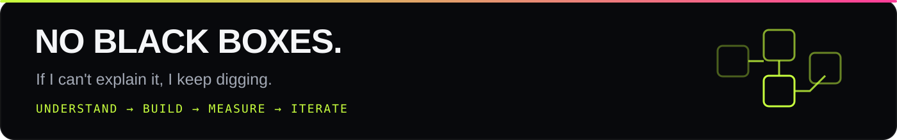

<div align="center">


<br>

<a href="https://github.com/JAuxance">
  
</a>

<br><br>

<a href="https://auxance.dev"></a>
<a href="https://getmanager.app"></a>
<a href="https://github.com/JAuxance/ai_journey"></a>


</div>

<br>



## `whoami`

French developer building **real software today**, with **ML research in China** as the long-term direction.

I like the whole path: low-level foundations, backend architecture, useful interfaces, training loops, and the unglamorous debugging in between. Not collecting frameworks — collecting **systems I can explain**.

```yaml
now:
  shipping: Manager — desktop focus & discipline app for Windows / Linux
  building: TaskFlow — collaborative project management, RNCP5 project
  learning: sentence embeddings · transfer learning · ML fundamentals
  studying: maths for ML · English → C1/C2 · Mandarin 中文

next:
  - CS licence
  - AI / research-oriented master
  - ML research in China — currently aiming for SJTU

rule: fundamentals_over_hype
```

---

## Selected builds

### 01 — Manager · **Discipline, made tangible.**

<a href="https://getmanager.app">
  
</a>

A free desktop app for **focus, discipline and long-term consistency**. Days, tasks, focus sessions, schedule, journal and review — with local data, optional sync, and Dona, the built-in AI coach.

`Windows` `Linux` `Free` `Local-first` `Auto-updates`

**[Visit getmanager.app →](https://getmanager.app)** · **[Download →](https://github.com/JAuxance/manager-releases/releases/latest)**

<br>

<table>
  <tr>
    <td width="50%" valign="top">
      <a href="https://github.com/JAuxance/TaskFlow">
        
      </a>
      <h3>02 — TaskFlow</h3>
      <p><b>Teamwork without the chaos.</b></p>
      <p>Workspaces, projects, Kanban tasks, roles and permissions. Built as a complete RNCP5 application, from data and auth to browser tests and deployment.</p>
      <p><code>Flask</code> <code>Vue 3</code> <code>TypeScript</code> <code>PostgreSQL</code> <code>Docker</code></p>
      <a href="https://github.com/JAuxance/TaskFlow"><b>Explore TaskFlow →</b></a>
    </td>
    <td width="50%" valign="top">
      <a href="https://github.com/JAuxance/ai_journey">
        
      </a>
      <h3>03 — AI Journey</h3>
      <p><b>A public ML lab, not a tutorial graveyard.</b></p>
      <p>Foundations, maths, experiments and released models. Every project records results, limits and next steps — because “it runs” is not the same as “I understand”.</p>
      <p><code>PyTorch</code> <code>NumPy</code> <code>scikit-learn</code> <code>Jupyter</code></p>
      <a href="https://github.com/JAuxance/ai_journey"><b>Enter the lab →</b></a>
    </td>
  </tr>
</table>

> **Current experiment:** Portfolio Bot “Trail” — V1 TF-IDF + logistic regression reached **0.629 macro F1**. V2 explores sentence embeddings and transfer learning. The target is improvement that can be **measured**, not just claimed.

---

## Tools I use to get there

<div align="center">

**LANGUAGES**


**PRODUCT & WEB**


**DATA, ML & INFRA**


</div>

---

## The lab notes

<table>
  <tr>
    <td width="33%" valign="top">
      <h3>BUILD</h3>
      <p>Ship the smallest honest version. Real users, real constraints, real files — not a stack diagram pretending to be a product.</p>
    </td>
    <td width="33%" valign="top">
      <h3>UNDERSTAND</h3>
      <p>Open the box. Write the matrix operations. Read the error. Explain the model. Cognitive debt is still debt.</p>
    </td>
    <td width="33%" valign="top">
      <h3>ITERATE</h3>
      <p>Measure the result, keep the receipt, improve the weakest part. V1 → V2 → V3, with each version standing on its own.</p>
    </td>
  </tr>
</table>

---

## GitHub, in numbers

<div align="center">


<br>


<br><br>


</div>

---

<div align="center">

### The destination is ambitious. The next commit is small.

**France → China · Software → ML research · Curiosity → Understanding**

<a href="https://auxance.dev"><b>auxance.dev</b></a> · <a href="https://github.com/JAuxance?tab=repositories"><b>All repositories</b></a> · <a href="https://getmanager.app"><b>Manager</b></a>

<br>


</div>
