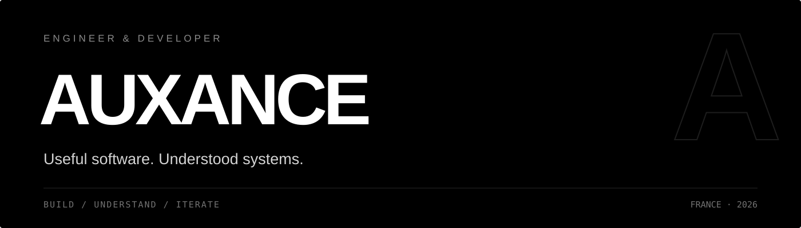
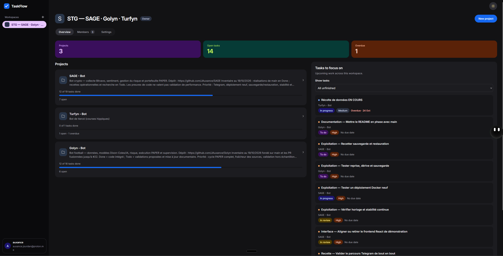

<div align="center">



<br>

<a href="https://auxance.dev"></a>
&nbsp;
<a href="https://getmanager.app"></a>
&nbsp;
<a href="https://github.com/JAuxance?tab=repositories"></a>

</div>

<br>

French engineer & developer. I build software I can explain — from the interface to the system underneath.

Currently shipping **Manager** and **TaskFlow**, strengthening my software engineering foundations, and moving toward **machine learning research in China**.

> **Understand first. Then build. Then make it better.**

---

## 01 / Manager

**Focus. Discipline. Long-term consistency.**

A free desktop app for Windows and Linux. Tasks, focus sessions, planning, journal and review — brought together in one quiet, deliberate interface.

<video src="https://raw.githubusercontent.com/JAuxance/JAuxance/main/assets/manager-line-final-web.mp4" poster="assets/manager-poster.jpg" controls muted playsinline width="100%"></video>

<br>

`Windows` &nbsp; `Linux` &nbsp; `Free` &nbsp; `Local-first` &nbsp; `Dona AI coach`

**[Discover Manager](https://getmanager.app)** &nbsp;·&nbsp; **[Download](https://github.com/JAuxance/manager-releases/releases/latest)** &nbsp;·&nbsp; **[Watch the film](https://raw.githubusercontent.com/JAuxance/JAuxance/main/assets/manager-line-final-web.mp4)**

---

## 02 / TaskFlow

**Teamwork, without the chaos.**

Collaborative project management built around workspaces, projects and a precise Kanban workflow. Authentication, roles, permissions, testing and deployment — the complete product, not just the interface.

<a href="https://github.com/JAuxance/TaskFlow">
  
</a>

<br>

`Flask` &nbsp; `Vue 3` &nbsp; `TypeScript` &nbsp; `PostgreSQL` &nbsp; `Docker`

**[Explore TaskFlow](https://github.com/JAuxance/TaskFlow)**

---

## What I work with

<table>
  <tr>
    <td width="33%" valign="top">
      <h3>Engineering</h3>
      <p>Python · TypeScript · JavaScript<br>C · Rust · Shell</p>
    </td>
    <td width="33%" valign="top">
      <h3>Product</h3>
      <p>Vue · React · Next.js · Flask<br>HTML · CSS · Tailwind</p>
    </td>
    <td width="33%" valign="top">
      <h3>Systems</h3>
      <p>PostgreSQL · Redis · Docker<br>Linux · Git · GitHub</p>
    </td>
  </tr>
</table>

```text
CURRENTLY
  Manager     Shipping and improving the desktop experience
  TaskFlow    Building the RNCP5 application end to end
  Learning    Better architecture, better interfaces, deeper fundamentals

PRINCIPLE
  No black boxes. No unnecessary complexity. No software without intent.
```

---

## Activity

<div align="center">


<br>


<br><br>


</div>

---

<div align="center">

**Build something useful. Make it feel inevitable.**

[auxance.dev](https://auxance.dev) &nbsp;·&nbsp; [Manager](https://getmanager.app) &nbsp;·&nbsp; [TaskFlow](https://github.com/JAuxance/TaskFlow)

</div>
