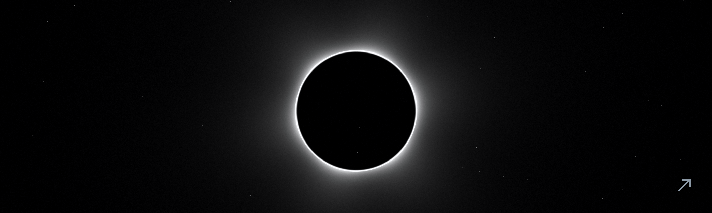
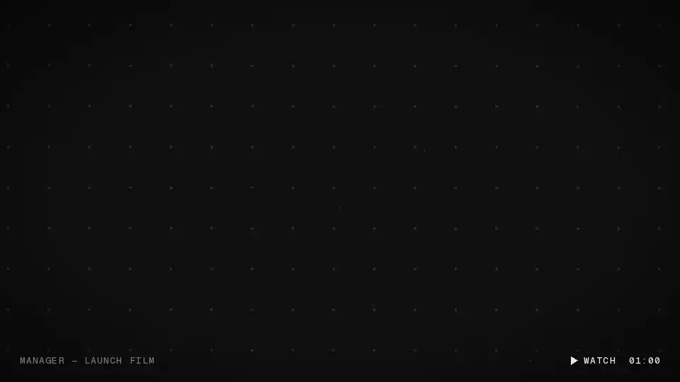
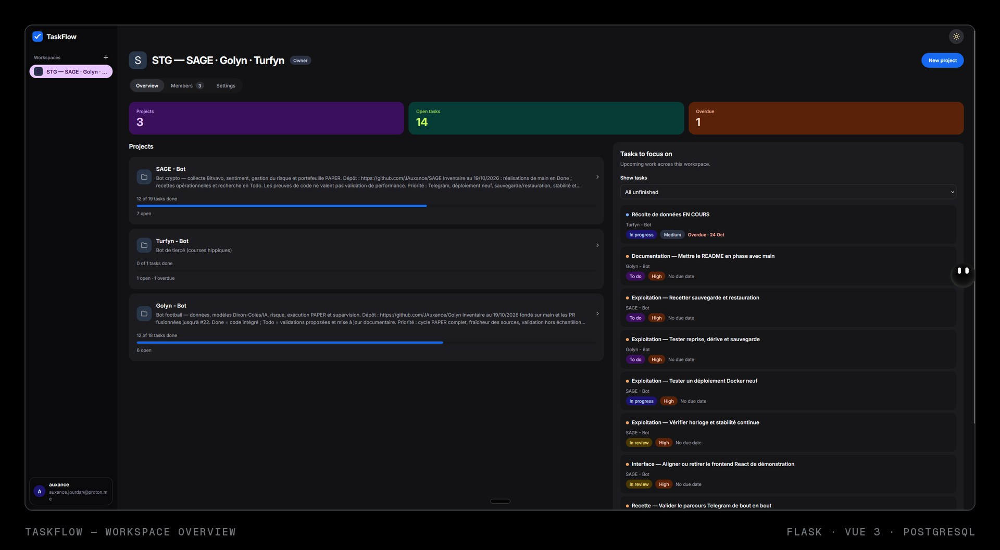

  <a href="https://auxance.dev"><b>auxance.dev</b></a>
  &nbsp;·&nbsp;
  <a href="https://getmanager.app">getmanager.app</a>
  &nbsp;·&nbsp;
  <a href="https://github.com/JAuxance?tab=repositories">Repositories</a>

French engineer and developer. I build desktop software and web products, and I like knowing how every layer underneath works.

Currently shipping **Manager** and **TaskFlow**. Next: machine learning research.

 

## `01` Manager

A free desktop app for focus, discipline and long-term consistency. Tasks, focus sessions, weekly schedule, journal and review in one quiet interface.

| | |
|---|---|
| **Platforms** | Windows · Linux (`.exe`, `.deb`, AUR) |
| **Stack** | Tauri v2 · Rust · JavaScript · SQLite |
| **Data** | Local-first, optional sync |
| **Updates** | Signed, installed automatically |
| **Coach** | Dona, optional AI coach |

**[getmanager.app](https://getmanager.app)** &nbsp;·&nbsp; [Download](https://github.com/JAuxance/manager-releases/releases/latest) &nbsp;·&nbsp; [Tour](https://getmanager.app/tour)

 

## `02` TaskFlow

Collaborative project management: workspaces, projects and a Kanban workflow. Built end to end, from authentication and permissions to tests and deployment.

| | |
|---|---|
| **Stack** | Flask · Vue 3 · TypeScript · PostgreSQL · Docker |
| **Scope** | Auth, roles, permissions, tests, deployment |
| **Context** | RNCP level 5 project |

**[github.com/JAuxance/TaskFlow](https://github.com/JAuxance/TaskFlow)**

 

## `03` Stack

<table>
  <tr>
    <td width="33%" valign="top">
      LANGUAGES 
      Python · TypeScript · JavaScript C · Rust · Shell
    </td>
    <td width="33%" valign="top">
      PRODUCT 
      Vue · React · Next.js · Flask Tauri · HTML · CSS
    </td>
    <td width="33%" valign="top">
      SYSTEMS 
      PostgreSQL · SQLite · Redis Docker · Linux · Nginx
    </td>
  </tr>
</table>

 

---

  <a href="https://auxance.dev">auxance.dev</a>
  &nbsp;·&nbsp;
  <a href="https://getmanager.app">getmanager.app</a>
  &nbsp;·&nbsp;
  France · 2026

